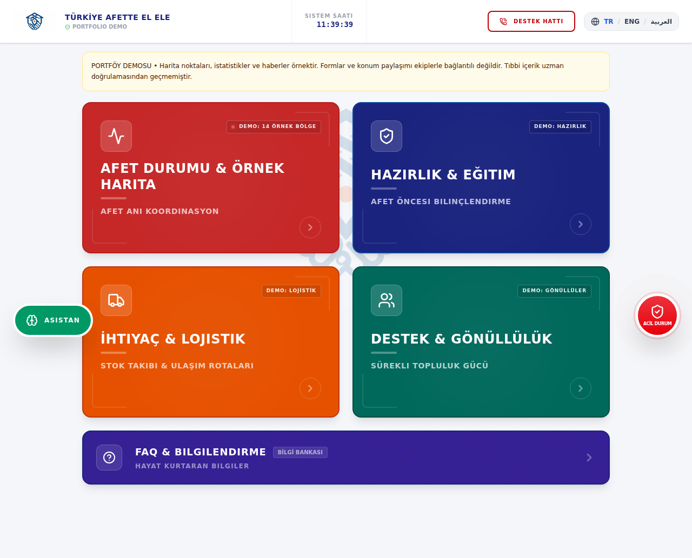
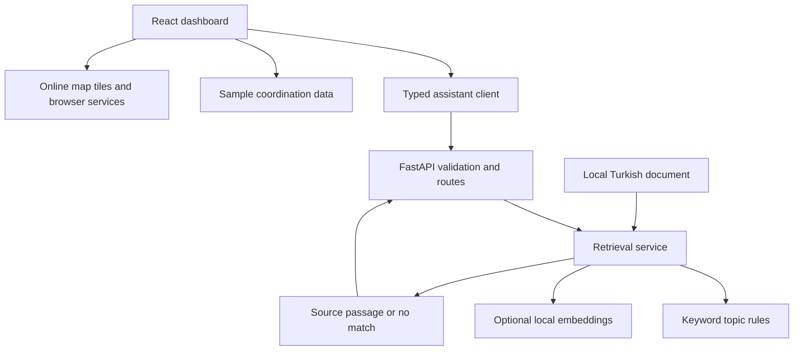
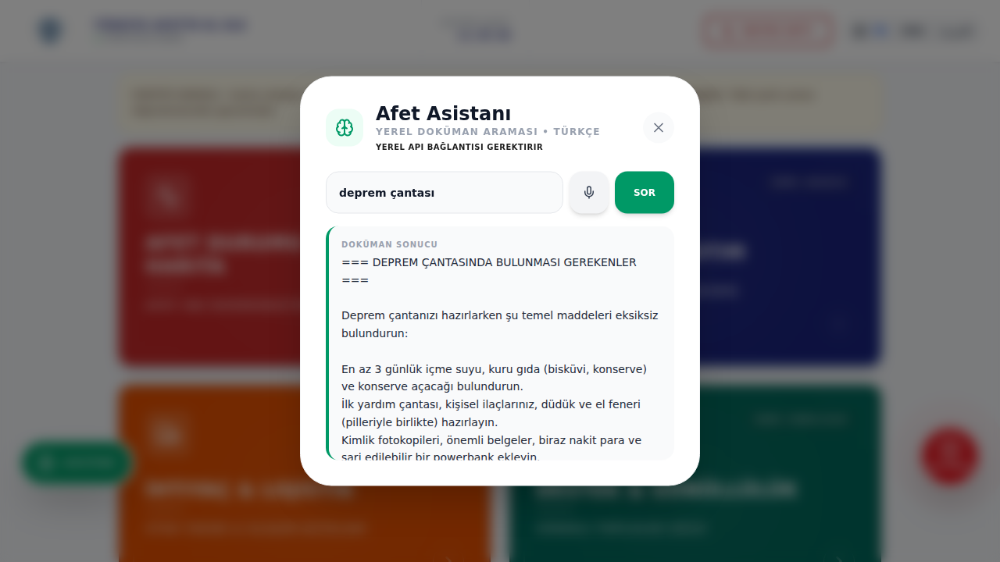
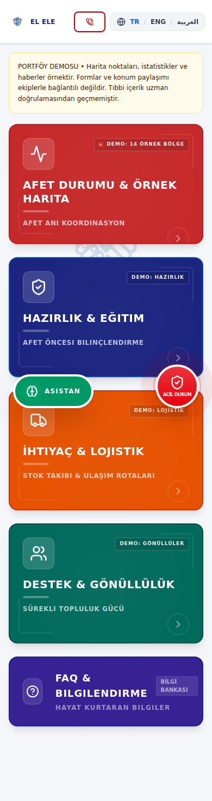

# Afette El Ele

**A local disaster-preparedness dashboard with a Turkish document-retrieval assistant.**

React · TypeScript · FastAPI · Python · optional Sentence Transformers · SQLite tooling

This portfolio project explores how a multilingual interface can expose local preparedness information without requiring a cloud AI API. The assistant retrieves passages from a bundled Turkish text document; it does not generate answers. Operational dashboards use sample data.

> **Educational prototype:** this is not an emergency dispatch system or a validated medical product. Map locations, news, volunteer tasks and statistics are demonstration data. Help forms do not contact responders. Source content has not been clinically reviewed.



## What works, and what is a demo?

| Component | Implementation | Boundary |
| --- | --- | --- |
| Dashboard | React views, TR/EN/AR interface, preparation checklists and sample coordination modules | Translation coverage is incomplete in some views |
| Assistant | Validated FastAPI endpoint; Turkish keyword routing; verbatim document passages; explicit no-match response | No generative LLM, diagnosis or accuracy guarantee |
| Optional semantic retrieval | Local Sentence Transformer adapter; precomputed title embeddings; similarity threshold | Requires a separately downloaded model; model quality has not been benchmarked |
| Map | Leaflet, sample city search and browser geolocation | Tiles require internet; locations are not verified assembly points |
| Help / volunteer forms | Interactive UI demonstrations | No submission backend, registration or dispatch |
| Logistics | Filtering and in-memory route creation | Resets when the view is unmounted; no shared database |
| Sound / voice | Bundled whistle audio; optional browser speech recognition | Playback requires browser permission; speech may use online services |
| SQLite utilities | Repeatable TXT/PDF ingestion and parameterized local search | Optional experiment; not used by the assistant API |

## Run locally

Prerequisites: **Node.js 22+**, **Python 3.11 or 3.12**. Initial dependency installation requires internet. The default assistant needs no API key and downloads no model.

```bash
git clone https://github.com/BilgehanYldrm/offline_AI-_agent.git
cd offline_AI-_agent
npm ci
python -m venv .venv
```

Activate the Python environment:

```powershell
# Windows PowerShell
.venv\Scripts\Activate.ps1
```

```bash
# macOS / Linux
source .venv/bin/activate
```

Then start the API:

```bash
python -m pip install -r requirements-dev.txt
python -m uvicorn backend.app:app --host 127.0.0.1 --port 8000
```

In a second terminal:

```bash
npm run dev
```

Open **http://127.0.0.1:3000**. Click **Asistan**, enter `deprem çantası`, and select **SOR**. API documentation is at **http://127.0.0.1:8000/docs**; readiness and active retrieval mode are at `/health`.

The development server proxies `/api` to the local backend. Existing `uvicorn ajan_sistemi:app` and `uvicorn ai_search:app` commands remain supported. For built assets, use the explicit API configuration in [setup](docs/SETUP.md); the dev proxy is not bundled into `dist`.

## Architecture



The API loads document blocks once at startup. Keyword routing runs first; an explicitly configured local model can handle unmatched queries. Low-scoring queries return no match instead of an unrelated passage. Query text is not logged or persisted by the application.

Read [architecture and decisions](docs/ARCHITECTURE.md), [setup and troubleshooting](docs/SETUP.md), and [the engineering audit](docs/AUDIT.md).

## Verification

```bash
python -m ruff check .
python -m pytest -q
npm run typecheck
npm test
npm run build
npx playwright install chromium
npm run test:e2e
```

Activate `.venv` before running browser tests, or set `PYTHON` to its interpreter path. Playwright starts both local servers and tests real API retrieval, no-match behavior, map search, failure handling and mobile layout. Screenshots in this README come from the running application, not design mockups. External HTTPS resources are blocked during the smoke tests.

GitHub Actions runs these checks on pull requests and pushes to `main` / `portfolio/**`, then uploads the build and browser report. **The workflow does not deploy.**



<details>
<summary>Mobile screenshot</summary>



</details>

## Offline scope

After dependencies are installed, the local frontend server, API, bundled images/audio and keyword search can run without an internet connection. Optional semantic retrieval also requires a model downloaded beforehand. There is **no service worker or installable PWA**: do not assume an arbitrary hosted URL will reload offline. Online maps, embedded videos, external links and browser speech services are outside the offline guarantee.

## Project layout

| Path | Responsibility |
| --- | --- |
| `src/App.tsx` | Existing dashboard views and interaction state |
| `src/data/` | Translations and sample assembly-point data |
| `src/services/assistant.ts` | Validated, timeout-bounded API client |
| `backend/app.py` | HTTP contract, lifecycle and origin restrictions |
| `backend/retrieval.py` / `topics.json` | Document parsing and retrieval rules |
| `data/` | Existing Turkish source document |
| `tests/`, `e2e/` | Backend and browser regression coverage |
| `examples/`, `database_prep.py`, `araclar.py` | Independent historical model / SQLite experiments |
| `docs/` | Audit, setup, architecture and portfolio notes |

## Next steps

Priority work is a reviewed source corpus and retrieval evaluation set, followed by further UI component extraction, accessibility testing, and an explicitly designed offline asset strategy. See the [30-day plan and CV / LinkedIn wording](docs/PORTFOLIO.md). Do not claim production readiness, live coordination, validated medical accuracy or measured model performance.

No project-wide license is declared yet. Original image/audio attribution and redistribution rights still need to be confirmed before a licensed public release.
