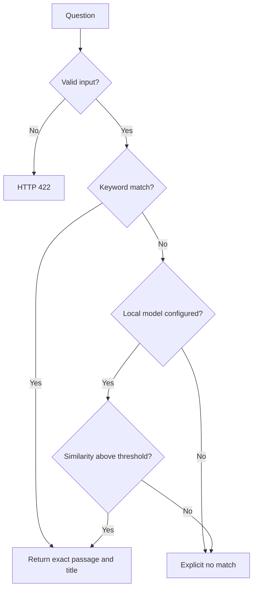

# Architecture and engineering decisions

## Boundaries

The React UI owns temporary interaction state. Translation tables and assembly-point fixtures are separate modules; the assistant service owns URL construction, HTTP errors, response validation and a 15-second timeout. Views retain the existing layout to reduce regression risk. `App.tsx` remains large: further feature extraction is planned, not claimed complete.

FastAPI owns request validation (trimmed, 1–1000 character questions), CORS and response serialization. A factory permits isolated app tests. Synchronous retrieval handlers run through FastAPI's worker mechanism rather than blocking an async endpoint with CPU inference. The document and optional embedding model are initialized during lifespan startup. Invalid document/model configuration prevents readiness rather than silently reporting a working AI service.

`RetrievalService` is independent of FastAPI. Turkish normalization makes uppercase dotted/dotless I consistent; ordered rules favor specific topics over generic roots. Word boundaries reduce accidental substring matches. This remains heuristic routing: negation, multiple simultaneous topics, misspellings and non-Turkish queries are not reliably understood.

The optional semantic adapter imports Sentence Transformers only when configured, accepts an existing local directory, and uses `local_files_only=True`. Title vectors are encoded once, then compared with normalized query vectors. The 0.65 cutoff is a conservative engineering default, **not a calibrated confidence probability**. No real-model evaluation has been performed for this revision.

## Request flow

## Compatibility

`POST /soru-sor` accepts `{ "soru": "deprem" }`. Responses retain `cevap`, `response` and `message`; `method`, `source` and `score` add retrieval provenance. `/ask`, `/chat` and `/api/chat` remain aliases. Root Python entrypoints still export `app`.

Intentional behavior changes: blank/oversized queries fail validation; unmatched queries no longer return the first document; default startup no longer downloads a BERT model; demo actions no longer claim an actual submission. The backend searches the known repository document rather than scanning arbitrary folders or a developer-specific Windows path.

## SQLite and historical experiments

The SQLite pipeline is independent of the HTTP API. It is retained for experimentation: ingestion replaces chunks for each source transactionally and uses paths relative to the repository. Deleted input files are not automatically purged from an existing database. Run with a new database when rebuilding a changed corpus. TXT ingestion needs only the standard library; PDF ingestion is optional.

`examples/ollama_sqlite.py` and `examples/foundry_catalog.py` preserve separate experiments. They are not connected to the UI and require external runtimes/dependencies. Their inference behavior has not been verified. The old nested snapshot and ZIP remain recoverable from base commit `fabfa3ea57ab98d74f16c195a4711b711588d739`; they are not active source trees.

## Security model

Intended for local development on loopback. No authentication, distributed rate limiting or public-hosting hardening is implemented. CORS limits browser origins but is not authentication. Keep the API off public interfaces. There are no cloud AI credentials in the browser build configuration. `VITE_*` values are public build-time configuration and must never contain secrets.

Questions are not persisted or explicitly logged. Browser speech recognition and external map/video requests have their own privacy behavior. Medical text and sample locations are not independently verified; the interface exposes that limitation.
